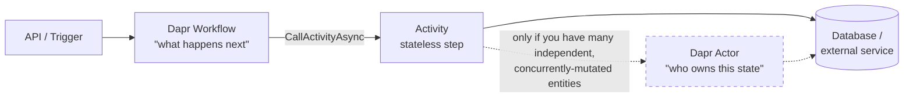
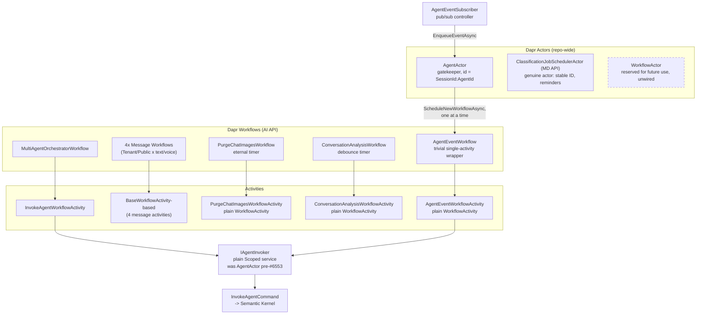

# Dapr Actors, Workflows & Activities — When to Use Which

- **ADO Task:** #6553 — Review and unify DAPR code (Actors, Workflow and Activities)
- **Parent Story:** #6480 — Dapr-based orchestration for multi-agent Claude workflows
- **Related docs:** [`docs/multi-agent-orchestration.md`](multi-agent-orchestration.md) (the one workflow this review is mostly about, in detail)
- **Update (#6589):** a new `AgentActor` now sits in front of `AgentEventWorkflow` — see Section 5. It reuses the removed name from Section 3 but is a genuinely different, legitimately stateful design; Sections 1–4 below are otherwise unchanged from the original #6553 review.

This task asked for a diagram explaining how Dapr Actors, Workflows, and Activities work together, plus a review of this repo's actual usage against that model. Two reference images were attached to the ADO task (ChatGPT-generated illustrations from the conversation that framed this task) but couldn't be decoded during planning — the diagrams below are written directly from that conversation's model rather than matching those images pixel-for-pixel, and supersede them as the living reference.

## 1. The conceptual model

> **Workflow = "what should happen next."** **Actor = "who owns this state."**

- **Dapr Workflow**: models a *business process*. Orchestrates a sequence of steps over time, with durable timers, automatic retries, and the ability to wait for external events. State is the workflow's own execution history — it survives restarts by replaying that history, not by anyone manually persisting it.
- **Dapr Activity**: a single stateless step a Workflow calls out to. Workflow code itself must stay deterministic (no I/O, no `DateTime.Now`, no random), so every real side effect — a DB call, an HTTP call, an LLM call — happens inside an Activity, never directly in workflow code.
- **Dapr Actor**: models a *stateful entity*. One actor instance per actor ID (like a class vs. an object instance), each with its own state and its own serialized execution queue — Dapr guarantees only one method call runs at a time per actor ID, while different IDs run fully in parallel. Actors are virtual: Dapr activates one on first use and deactivates it when idle, so millions of logical entities cost nothing while inactive. Actors support reminders/timers scoped to that entity's own lifecycle (e.g. "wake this actor up in 30 minutes").

The Actor branch is dashed because it's **optional** — plenty of correct Dapr apps are just `API → Workflow → Activities → Database` with no Actor at all. Reach for an Actor only when a single, long-lived entity is mutated by many independent, potentially concurrent callers and needs its own serialized queue of operations (an order being updated by a customer, a warehouse, and a payment webhook at the same time; a device with a heartbeat). A Workflow already gives you durable, replayable orchestration for everything else — most business processes (approvals, ETL, onboarding, this repo's multi-agent pipeline) never need an Actor at all.

## 2. This repo's actual usage, reviewed against that model

| Component | Kind | Verdict |
|---|---|---|
| `ClassificationJobSchedulerActor` (MD API) | Dapr Actor | ✅ **Genuine actor.** Stable ID per `(tenantId, agentId)`, reused across many calls over time, real `RegisterReminderAsync`/`IRemindable` debounce logic. This is the model actor example in this repo. |
| `AgentActor` (removed, #6553) | *was* a Dapr Actor | ❌ **Was activity-in-disguise.** Fresh actor ID every call (`"{orchestrationInstanceId}:{agentRole}"` or `"event:{eventType}:{instanceId}"`), state set-then-immediately-removed within the same call, no reminders, exactly one invocation per ID by design. Converted to `IAgentInvoker`, a plain `Scoped` service — see Section 3. |
| `WorkflowActor` (`Common/Activities/`) | Dapr Actor | 🔶 **Reserved for future use.** Empty class, registered in DI, zero call sites today — intentionally kept as scaffolding, not dead code to delete. |
| `MultiAgentOrchestratorWorkflow` + `InvokeAgentWorkflowActivity` | Workflow + Activity | ✅ Sequential lead step, fan-out/fan-in across reviewers, retry policy per call. Textbook Workflow+Activity shape, no Actor needed. |
| 4 message workflows (`MessageTenantAgentByIdWorkflow`, etc.) | Workflow + Activity | ✅ Trivial single-activity wrappers around a queued command. Real duplication across the 4 (out of scope for #6553 — see Section 4). |
| `PurgeChatImagesWorkflow` | Workflow (eternal) | ✅ Timer + `ContinueAsNew` recurring cleanup — a good Workflow use, no Actor. |
| `ConversationAnalysisWorkflow` | Workflow | ✅ Debounce timer + one activity — good Workflow use, no Actor. |
| `AgentEventWorkflow` + `AgentEventWorkflowActivity` | Workflow + Activity | ✅ Trivial single-activity wrapper, activity calls `IAgentInvoker` directly (same reason `InvokeAgentWorkflowActivity` skips `BaseWorkflowActivity`). Scheduled by `AgentActor` (below), not by the subscriber directly, as of #6589. |
| `AgentActor` (reintroduced, #6589) | Dapr Actor | ✅ **Genuine actor, unlike its #6553 namesake.** ID = `"{SessionId}:{AgentId}"`, reused across every event for that session/agent pair; the only persisted state is the queue itself — no separate "is a workflow running" flag (see Section 5 for why that was dropped) — plus a recurring `IRemindable` reminder that arms on enqueue and disarms once drained. |

### Repo-mapped diagram (post-#6553)

## 3. Why `AgentActor` was converted, not just documented

`AgentActor`'s own doc comment said each call is "invoked exactly once... no state carries over between actor instances" — that's a description of a stateless RPC, not a stateful entity. The actor boundary bought nothing here except a heavier serialization contract: Dapr's typed actor-remoting proxy uses `DataContractSerializer` (XML), which failed outright on Semantic Kernel's `ChatMessageContent`/`KernelContent` types nested in the request — one of three real bugs found and fixed in this exact code path on the same day this task was picked up (the other two: a matching Mapster same-type mapping failure on the same objects, and an unrelated EF Core `OfType<RunnableAgent>().Include(...)` failure in the agent lookup underneath it).

The fix: `IAgentInvoker`/`AgentInvoker` (`AI.Application/Agents/Invocation/`) — a plain `Scoped` service with the same single method, called directly from `InvokeAgentWorkflowActivity` (the orchestrator's workflow path) and `AgentEventWorkflowActivity` (the pub/sub path — `AgentEventSubscriber` itself just schedules `AgentEventWorkflow` and returns, aligned with every other subscriber in this codebase rather than doing real work inline in the controller). Both activity callers already get a fresh DI scope per invocation, so `AgentInvoker` no longer needs to manually create its own scope the way the actor did — it just constructor-injects `TenantContext`/`ChatContext`/`UserContext`/`AgentSharableContext` directly. No actor id, no actor-runtime registration, no remoting serialization boundary at all: the call is a normal in-process method call.

## 4. Known inconsistencies flagged, not fixed here (out of scope for #6553)

- **`MultiAgentOrchestratorSubscriber`** builds its workflow input directly from the queued command rather than using the same state-store key-indirection pattern the other subscribers (`AIWorkerSubscriber`, `VoiceWorkerSubscriber`) use. Worth aligning for consistency, but deliberately not touched in the same pass as the `AgentActor` conversion — two risky changes to the same pipeline in one sitting is one too many. Follow-up ticket if wanted.
- **4 duplicate message workflows/activities** (`MessageTenantAgentByIdWorkflow`, `MessagePublicAgentByShareIdWorkflow`, `VoiceMessageTenantAgentByIdWorkflow`, `VoiceMessagePublicAgentByShareIdWorkflow`, plus their 4 paired activities) are near-identical single-activity wrappers. Real duplication, but a mechanical DRY refactor orthogonal to the Actor-vs-Workflow question this task is actually about. Follow-up ticket if wanted.
- **`PurgeChatImagesWorkflowActivity`/`ConversationAnalysisWorkflowActivity` not using `BaseWorkflowActivity`** — verified this is *not* an oversight: `PurgeChatImagesWorkflowActivity` is a stateless blob sweep with no per-item command/idempotency concept at all, and `ConversationAnalysisWorkflowActivity` already has its own fit-for-purpose atomic `ExecuteUpdateAsync` claim guard suited to its timer/domain-event trigger. `BaseWorkflowActivity`'s idempotency-by-state-store-key layer exists specifically for the pub/sub-triggered, correlation-key-indirected command path — forcing these two onto it would be a false equivalence. No ticket needed; documented here as a resolved question, not an open one.

## 5. `AgentActor` gatekeeper (#6589) — why an actor is justified here, unlike #6553's

Section 3 above converted the original `AgentActor` to `IAgentInvoker` precisely because that actor's ID was fresh on every call and nothing persisted between invocations — Section 1's own bar ("a single, long-lived entity mutated by many independent, potentially concurrent callers, needing its own serialized queue of operations") wasn't met. Task #6589 reintroduces an `AgentActor` class for a genuinely different case that *does* meet that bar:

- **The entity:** the set of pending `AgentEventMessage`s for one `(SessionId, AgentId)` pair — actor ID `"{SessionId}:{AgentId}"`, stable and reused across every event for that pair, not minted per call.
- **The concurrent callers:** `AgentEventSubscriber` can receive multiple events for the same session/agent in close succession (e.g. several async task-completion notifications firing near-simultaneously) — Dapr's pub/sub delivery gives no ordering or mutual-exclusion guarantee across those.
- **The serialized queue this actor owns:** each event's `statestore-ai` correlation key is queued in the actor's own `StateManager` state (never the `AgentEventMessage`/Semantic Kernel payload itself — see below), and `AgentEventWorkflow` instances are started strictly one at a time per actor ID.
- **Avoiding #6553's actual failure mode:** the reason the *original* `AgentActor` broke wasn't "actors are wrong here" in the abstract — it was that its remoting proxy serialized method arguments with `DataContractSerializer` (XML), which choked on Semantic Kernel's `ChatMessageContent`/`KernelContent` types. This `AgentActor`'s only method, `EnqueueEventAsync(string messageKey)`, takes and returns nothing but a plain string (the existing state-store key) — it never puts an SK type anywhere near the actor boundary, by design, not by accident.
- **Pure logic extracted for testability:** `AgentActor` itself (Dapr state/reminder/workflow-client I/O) isn't unit-testable from outside the SDK — `ActorHost.CreateForTest`'s state provider hook is internal to the `Dapr.Actors` assembly. All actual queue logic lives in `AgentActorGatekeeper` (`Application/Agents/Actors/`), a pure static class taking/returning plain data, fully covered by `AgentActorGatekeeperTests`.

### 5.1. Revision: dropped the `WorkflowRunning` boolean in favor of a blocking wait

The first working version of `AgentActor` matched the ADO task's literal spec: a persisted `WorkflowRunning` bool + `RunningInstanceId` string, reconciled every ~5s by a reminder polling `DaprWorkflowClient.GetWorkflowStateAsync` to decide whether the current workflow had finished. In practice this produced two real bugs:

1. **`null`-as-finished ambiguity.** Right after `ScheduleNewWorkflowAsync` returns, there's a real eventual-consistency window where the engine hasn't yet persisted the instance, so `GetWorkflowStateAsync` can legitimately return `null` for a workflow that's actually still active — not one that's gone. The first fix (treat `null` as "not finished, retry next tick" — see `AgentActorGatekeeper.IsWorkflowFinished`) closed that specific gap.
2. **State-ordering fragility.** The `WorkflowRunning`/`RunningInstanceId`/`Queue` writes were three separate, independently-timed `SetStateAsync` calls whose correctness depended on all three always executing together in the right order. It was easy (and happened) to accidentally scope one of them behind a condition that made sense for the *scheduling* side effect but silently skipped a *state* write that needed to happen unconditionally — leaving `WorkflowRunning` stuck stale.

Both bugs trace to the same root cause: **tracking "is a workflow running" as separate, persisted state that has to be kept in sync with reality is inherently driftable.** The fix was to stop tracking it at all. `AgentActor` now persists only the `queue` (`List<string>`). `ReceiveReminderAsync` peeks the head-of-queue candidate, checks its real Dapr Workflow state via `GetWorkflowStateAsync` first (scheduling only if that returns `null`, i.e. never scheduled), and then — if not already terminal — blocks its own turn on `DaprWorkflowClient.WaitForWorkflowCompletionAsync` (bounded by a `CancellationTokenSource` timeout, since it "may block indefinitely" for eternal workflows per the SDK's own docs; `AgentEventWorkflow` isn't eternal, so a generous multi-minute bound is enough). Only once that returns does it dequeue and move to the next item.

This works because Dapr's turn-based per-actor-ID concurrency (only one method/reminder call executes at a time for a given actor ID) *is* the "only one workflow at a time" guarantee — there's no longer a separate fact to track and no window where a stale flag can diverge from what Dapr's workflow engine actually knows. The `GetWorkflowStateAsync`-first check also turns actor-restart recovery (the queue still has the same head item, possibly already scheduled) into a normal path — it just skips straight to waiting — instead of a duplicate-schedule error. The reminder is kept as a ~5s periodic dead-man's-switch fallback in case an immediate re-arm is ever missed, but it's no longer the primary driver of state transitions.
